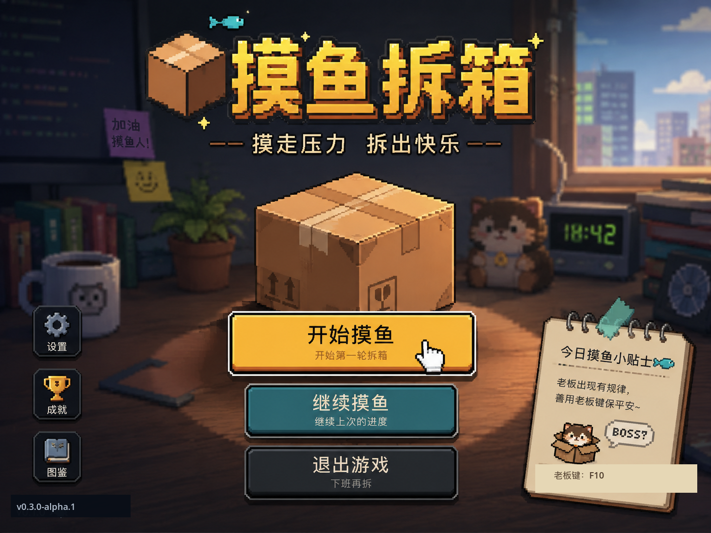
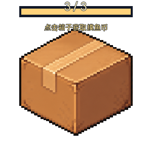
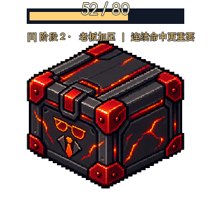
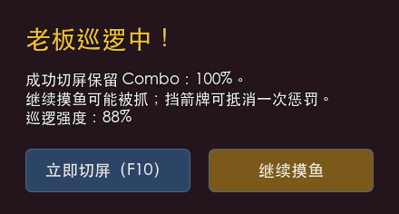
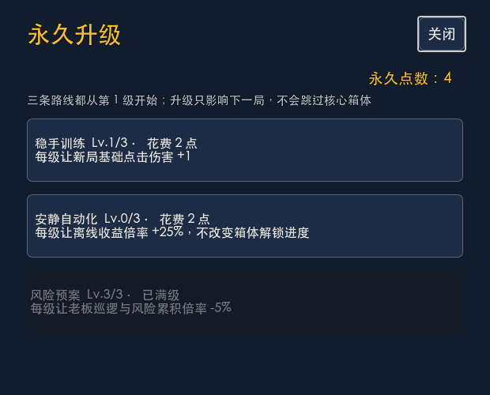

# 摸鱼有限公司

**摸走压力，拆出快乐。**

一款像素风桌面常驻游戏，把拆箱、放置成长与 Roguelite 构筑放进日常桌面。点碎突然出现的小纸箱，攒下摸鱼币，把手里的工具越升越强，再决定这一局走点击流、挂机流，还是高收益的风险路线。老板巡逻随时可能打断你的节奏，最后还有一只老板箱等你挑战。

[下载 macOS 试玩版](https://github.com/wuuu111/moyu-gaming/raw/refs/heads/main/moyu-gaming-macos.zip) · [版本发布页](https://github.com/wuuu111/moyu-gaming/releases/tag/v0.3.0-alpha.1) · [反馈问题](https://github.com/wuuu111/moyu-gaming/issues)



## 一局怎么玩

1. **开始拆箱**。进入行动轮，点击桌面上的箱子造成伤害。击破后收集摸鱼币与箱体点，连续命中和暴击带来更强的反馈。
2. **解锁更难的目标**。从普通纸箱逐步推进到更高等级的箱体，还会遇到移动、加固、恢复等不同机制。
3. **轮末做一次决定**。标准模式每轮约 60 秒，结束后暂停行动。你可以升级工具、购买道具或存钱，再进入下一轮。
4. **搭出自己的路线**。围绕点击伤害、自动攻击或风险收益选择道具，结合金币预算决定眼下变强还是为后续积累。
5. **挑战老板箱**。推进本局进度，迎接分阶段的终局战斗。结算后获得永久点数、解锁内容与历史记录，为下一局继续成长。

标准模式以约 30 分钟的完整单局为目标，也可以暂停、保存进度，下次回来继续。

## 游戏特色

### 箱子出现在桌面上

游戏采用透明桌面悬浮窗口。箱子以独立小窗口出现，顶部状态栏显示金币、轮次和老板风险，边缘侧栏提供工具、背包、升级、图鉴、成就和设置入口。桌面透明区域的点击穿透与多屏体验仍在 Alpha 阶段验收中。

### 从一根手指，升级到更强的工具

击破箱子赚取金币，在轮末提高点击伤害。不同箱子的耐久与机制会改变你的拆箱节奏，让升级工具、追求暴击和选择目标都有各自的作用。

<table>
  <tr>
    <td align="center"><br>从第一只纸箱开始</td>
    <td align="center"><br>挑战分阶段老板箱</td>
  </tr>
</table>

### 点击、挂机、风险，三条构筑路线

| 路线 | 玩法侧重 |
| --- | --- |
| 点击流 | 通过工具升级、点击增益与暴击强化主动拆箱 |
| 挂机流 | 利用自动攻击类道具，逐步减少持续点击的负担 |
| 风险流 | 围绕老板巡逻与收益倍率，权衡奖励和被抓的代价 |

道具存在持续轮数、前置条件或冲突限制。轮末还可以消耗金币重抽选择，让每局的成长取舍有所不同。

### 老板来了，切屏还是继续摸鱼

巡逻事件会给出风险提示。你可以使用老板键切换到虚构工作内容的伪装页面，也可以选择继续摸鱼、承担被抓的风险。老板键默认绑定 **F10**，支持在设置里重绑。



### 下班之后，成长还能留下

每局结算后，永久点数可以投入稳手训练、安静自动化和风险预案。成就、已解锁模式与历史记录跨局保留，新的尝试会逐步丰富后续选择。



## 六种游戏模式

标准摸鱼作为起点，特殊模式随进度解锁。

| 模式 | 主要变化 |
| --- | --- |
| 标准摸鱼 | 体验完整的轮次、成长和老板箱挑战 |
| 疯狂加班 | 箱子更密集，风险与局外奖励更高 |
| 精准暴击 | 普通点击伤害降低，暴击倍率提高 |
| 清台挑战 | 尽量零逃脱清场，漏箱会影响收益 |
| 极速下班 | 更短的行动轮，更快的推进与更强的老板箱 |
| 无尽工位 | 击破老板箱后继续提高强度，挑战更高分数 |

## 下载与运行

当前提供 **macOS Universal** 试玩包，支持 Apple 芯片与 Intel Mac，版本为 **0.3.0-alpha.1**，下载大小约 **72 MB**。

1. 下载 [moyu-gaming-macos.zip](https://github.com/wuuu111/moyu-gaming/raw/refs/heads/main/moyu-gaming-macos.zip)。
2. 解压后打开其中的 `.app`，也可以先将应用拖入“应用程序”文件夹。
3. 在开始页选择“开始摸鱼”。已有本地进度时，可以选择“继续摸鱼”。

当前包尚未完成 Apple Developer ID 签名和公证，首次打开可能受到 macOS 安全机制限制。

可使用仓库中的 [SHA-256 校验文件](moyu-gaming-macos.zip.sha256)核对下载内容，在 ZIP 所在目录运行以下命令。

```bash
shasum -a 256 -c moyu-gaming-macos.zip.sha256
```

## 基本操作

| 操作 | 默认方式 |
| --- | --- |
| 攻击箱子 | 鼠标左键点击箱子 |
| 展开侧栏 | 将鼠标移到屏幕左侧边缘 |
| 暂停 / 恢复 | Esc |
| 打开菜单 | M |
| 老板键 / 恢复游戏 | F10 |
| 轮末决策 | 在结算页选择升级工具、道具或存钱 |

快捷键可以在设置中调整。部分 Mac 的功能键设置可能需要配合 Fn 使用 F10。设置还提供音量、静音、降低动效、震屏反馈与窗口恢复选项。

## 本地进度与隐私

进度保存在本机，支持自动保存和继续游戏。老板键伪装页使用游戏内的虚构项目与指标，游戏的桌面机制遵循不读取真实工作窗口内容、剪贴板、进程列表或外部工作数据的边界。

## Alpha 试玩状态

当前版本处于持续迭代阶段。游戏包已通过 ZIP 完整性、运行资源检查和干净配置下的无界面启动检查，仍有以下待完成项。

- 工作台道具效果与持续时间显示的自动检查尚未通过。
- 透明区域点击穿透、失焦老板键、多屏及长时间运行仍需进一步人工验收。
- macOS 发布签名与公证尚未完成。

上方截图来自现有 Alpha 界面捕获，部分使用测试状态展示，画面中的金币、等级和战斗数值为示例。

遇到问题时，可以在 [Issues](https://github.com/wuuu111/moyu-gaming/issues)描述复现步骤、Mac 芯片类型和 macOS 版本，并附上游戏界面截图。
